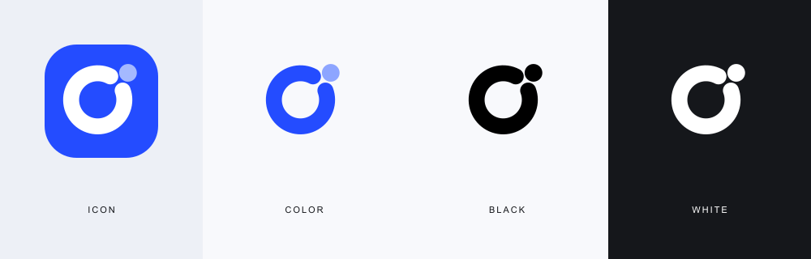

# overtrue logo

同一个图案，针对不同背景和用途提供四个版本。

| 版本 | SVG | PNG · 1024 × 1024 | 用途 |
| --- | --- | --- | --- |
| 蓝底方形 | [favicon.svg](../favicon.svg) | [icon.png](./icon.png) | 头像、应用图标、favicon |
| 透明彩色 | [mark-color.svg](./mark-color.svg) | [mark-color.png](./mark-color.png) | 浅色网页、文档、演示 |
| 透明纯黑 | [mark-black.svg](./mark-black.svg) | [mark-black.png](./mark-black.png) | 单色打印、浅色背景 |
| 透明纯白 | [mark-white.svg](./mark-white.svg) | [mark-white.png](./mark-white.png) | 深色背景、图片水印 |

优先使用 SVG；不支持 SVG 时使用 PNG。不要拉伸或改变图案比例，四周留出至少一个圆点直径的空白。头像使用蓝底方形版，避免透明图案被平台背景吞掉。

主色：`#244CFF`。纯黑与纯白版的圆环、圆点统一为同一颜色，便于单色印刷。
